# SismoWatch — Plataforma de Datos Sísmicos en Tiempo Casi Real (SuperApp)

[](https://fastapi.tiangolo.com)
[](https://airflow.apache.org)
[](https://www.postgresql.org)
[](https://react.dev)
[](https://docs.pytest.org)
[](https://bandit.readthedocs.io)

---

## 1. Propósito de la Arquitectura y Valor de Negocio

**SismoWatch** es la plataforma de datos en tiempo casi real de SuperApp concebida para los equipos de **Operaciones** y **Gestión de Riesgo**.

### Problema que resuelve:
El feed público de USGS (`all_hour.geojson`) cambia dinámicamente minuto a minuto sin almacenar historial consolidado, sin compuertas de validación física/espacial y sin resúmenes ejecutivos accionables.

### Decisiones que habilita:
1. **Activación de protocolos de contingencia en menos de 5 minutos:** Alertas de eventos de alta intensidad ($M \ge 6.0$) o alertas de tsunami transmitidas en vivo vía Server-Sent Events (SSE).
2. **Confiabilidad analítica sin degradación histórica:** Separación estricta en capas Medallion (`raw`, `staging`, `curated`). Los registros corruptos son retenidos en staging con su motivo de rechazo y jamás contaminan los KPIs de negocio.
3. **Reportes ejecutivos diarios con IA sin alucinaciones:** Resúmenes generados con Google Gemini (`gemini-3.5-flash` / `gemini-2.5-flash-lite`) cuyas cifras son calculadas previamente en Python/SQL y verificadas antes de su publicación.

---

## 2. Diagrama de Componentes y Flujo de Datos

```mermaid
flowchart LR
    subgraph Externa["Fuente Pública (USGS)"]
        F_RT["Feed 5 min<br/>all_hour.geojson"]
        F_HIST["API Histórica<br/>Query 30 días"]
    end

    subgraph Airflow["Orquestación: Apache Airflow (LocalExecutor)"]
        D_ING["dag_usgs_ingest_realtime<br/>(Cada 5 min)"]
        D_BACK["dag_usgs_backfill_30d<br/>(Parametrizado)"]
        D_TR["dag_usgs_transform_and_quality<br/>(Dataset Trigger)"]
        D_AI["dag_ai_daily_report_and_anomalies<br/>(Diario / On-Demand)"]
    end

    subgraph Postgres["PostgreSQL 16 (1 Contenedor Único - sismowatch_db)"]
        subgraph Bronze["Schema: raw (Bronze)"]
            T_RAW[("raw.earthquake_events_raw<br/>(Payload GeoJSON íntegro)")]
        end
        subgraph Silver["Schema: staging (Silver)"]
            T_STG[("staging.earthquake_events<br/>(Tipado + is_valid + validation_errors)")]
        end
        subgraph Gold["Schema: curated (Gold)"]
            T_CUR[("curated.earthquake_events<br/>(Solo registros válidos)")]
            T_QUAL[("curated.data_quality_runs<br/>(Métricas y Score)")]
            T_ANOM[("curated.seismic_anomalies<br/>(DBSCAN + Z-Score)")]
            T_REP[("curated.ai_daily_reports<br/>(Narrativa validada)")]
            T_LOG[("curated.ai_execution_logs<br/>(Tokens, latencia, costo)")]
        end
    end

    subgraph IA_Engine["Motor de IA y Anomalías"]
        ML["scikit-learn<br/>(DBSCAN + Z-Score)"]
        GEMINI["Google Gemini API<br/>(Structured Outputs)"]
        FALLBACK["Plantilla Determinista<br/>(Plan Alterno Jinja2)"]
    end

    subgraph Plataforma["Plataforma de Consumo"]
        API["Backend FastAPI (:8000)<br/>JWT + RBAC + SSE"]
        WEB["Frontend React + Vite (:3000)<br/>Dashboard, Mapa, Reportes"]
    end

    F_RT -->|HTTPS + Timeout| D_ING
    F_HIST -->|Ventanas 5 días| D_BACK
    D_ING -->|role_ingest: UPSERT| T_RAW
    D_BACK -->|role_ingest: UPSERT| T_RAW
    D_ING -.->|Dataset Event| D_TR
    D_BACK -.->|Trigger| D_TR

    T_RAW -->|role_transform| D_TR
    D_TR -->|Normalización y Reglas| T_STG
    D_TR -->|Métricas de corrida| T_QUAL
    T_STG -->|Promoción WHERE is_valid = TRUE| T_CUR

    T_CUR -->|Lectura 24h| D_AI
    D_AI --> ML --> T_ANOM
    D_AI -->|Métricas SQL + Place Sanitizado| GEMINI
    GEMINI -.->|Error / Timeout / Desfase numérico| FALLBACK
    GEMINI --> T_REP
    FALLBACK --> T_REP
    GEMINI --> T_LOG

    T_CUR -->|role_readonly| API
    T_QUAL -->|role_readonly| API
    T_ANOM -->|role_readonly| API
    T_REP -->|role_readonly| API
    T_STG -.->|Solo Admin: WHERE is_valid = FALSE| API

    API <-->|REST + SSE /api/stream| WEB
    API -.->|Admin Trigger REST| Airflow
```



---

## 3. Puesta en Marcha desde Cero (Guía Multiplataforma: Linux y Windows)

Esta sección describe el proceso completo para desplegar y verificar el ecosistema **SismoWatch** en una máquina limpia, tanto en entornos **Linux** como en **Windows**.

---

### 3.1 Requisitos Previos del Sistema

| Componente | Requisito en Linux | Requisito en Windows |
| :--- | :--- | :--- |
| **Sistema Operativo** | Ubuntu 22.04+ / Debian 12+ / Fedora / Arch | Windows 10 (Build 19041+) o Windows 11 (64-bit) |
| **Virtualización / Docker** | Docker Engine 24+ y Docker Compose v2 | [Docker Desktop](https://www.docker.com/products/docker-desktop/) con backend **WSL 2** activado |
| **Python** | Python 3.10, 3.11 o 3.12 (`python3-venv`, `python3-pip`) | Python 3.10+ (marcar casilla *"Add python.exe to PATH"*) |
| **Control de Versiones** | Git (`sudo apt install git`) | [Git for Windows](https://git-scm.com/download/win) (Git Bash recomendado) |
| **Opcional: Motor IA Local** | [Ollama](https://ollama.com) con modelo `llama3:8b` | [Ollama for Windows](https://ollama.com/download/windows) con `llama3:8b` |

> [!IMPORTANT]
> **En Windows**: Asegúrate de que Docker Desktop esté abierto y con el icono de la ballena en verde antes de ejecutar comandos de Docker. Se recomienda ejecutar las instrucciones en **PowerShell** (como Administrador) o en **Git Bash**.

---

### 3.2 Despliegue Rápido en Una Sola Línea (One-Liner)

#### En Linux / macOS / WSL 2:
```bash
cp .env.example .env && \
python3 -m venv .venv && \
source .venv/bin/activate && \
pip install --upgrade pip && \
pip install -r requirements.txt && \
pytest tests && \
mkdir -p airflow/logs && chmod -R 777 airflow/logs && \
docker compose up -d --build
```

#### En Windows (PowerShell):
```powershell
Copy-Item .env.example .env ; `
python -m venv .venv ; `
.\.venv\Scripts\Activate.ps1 ; `
python -m pip install --upgrade pip ; `
pip install -r requirements.txt ; `
pytest tests ; `
New-Item -ItemType Directory -Force -Path airflow/logs ; `
docker compose up -d --build
```

---

### 3.3 Paso a Paso Exhaustivo desde Cero

#### Paso 1: Clonar o extraer el proyecto
Abre tu terminal y ubícate en la raíz del repositorio:
```bash
# Vía Git:
git clone <url-del-repositorio> sismowatch
cd sismowatch

# O si recibiste el archivo comprimido .zip:
# Extrae el archivo y entra en la carpeta descomprimida
```

---

#### Paso 2: Crear el archivo de variables de entorno (`.env`)
El repositorio contiene una plantilla segura preconfigurada ([`.env.example`](file:///.env.example)).

- **En Linux / macOS / Git Bash:**
  ```bash
  cp .env.example .env
  ```
- **En Windows (PowerShell):**
  ```powershell
  Copy-Item .env.example .env
  ```
- **En Windows (CMD):**
  ```cmd
  copy .env.example .env
  ```

> *.env viene preconfigurado con claves seguras autogeneradas (Fernet Key de Airflow, Secret Key de JWT, contraseñas de usuarios segregados de PostgreSQL y credenciales iniciales `admin` y `viewer`).*

*(Opcional: Si dispones de una API Key de Google Gemini para los reportes diarios con IA generativa, abre `.env` en tu editor y colócala en `GEMINI_API_KEY=AIzaSy...`).*

---

#### Paso 3: Crear y activar el entorno virtual de Python (`.venv`)

- **En Linux / macOS:**
  ```bash
  # 1. Crear entorno virtual
  python3 -m venv .venv

  # 2. Activar entorno virtual
  source .venv/bin/activate
  ```

- **En Windows (PowerShell):**
  ```powershell
  # 1. Crear entorno virtual
  python -m venv .venv

  # 2. Permitir ejecución de scripts (si no lo has hecho antes)
  Set-ExecutionPolicy -ExecutionPolicy RemoteSigned -Scope Process -Force

  # 3. Activar entorno virtual
  .\.venv\Scripts\Activate.ps1
  ```

- **En Windows (CMD o Git Bash):**
  ```cmd
  REM En CMD clásico:
  python -m venv .venv
  call .venv\Scripts\activate.bat

  REM En Git Bash:
  python -m venv .venv
  source .venv/Scripts/activate
  ```

*(Sabrás que está activo porque aparecerá `(.venv)` al inicio de tu línea de comandos).*

---

#### Paso 4: Actualizar pip e instalar dependencias locales
Instala el paquete unificado de dependencias técnicas y de testing definido en [`requirements.txt`](file:///requirements.txt):
```bash
python -m pip install --upgrade pip
pip install -r requirements.txt
```

---

#### Paso 5: Validar el sistema con la suite de pruebas automatizadas (Pytest)
Antes de construir los contenedores, ejecuta la batería completa de 21 pruebas unitarias e integración para certificar la integridad de los componentes:
```bash
pytest tests
```
*(Todas las 21 pruebas deben finalizar en estado `PASSED`, certificando la seguridad RBAC, integridad sintáctica de DAGs de Airflow, compuertas de calidad de datos y funciones de transformación GeoJSON).*

---

#### Paso 6: Preparar directorios de logs y permisos
Apache Airflow requiere una carpeta de logs con permisos de escritura para el contenedor:

- **En Linux / macOS:**
  ```bash
  mkdir -p airflow/logs && chmod -R 777 airflow/logs
  ```
- **En Windows (PowerShell):**
  ```powershell
  New-Item -ItemType Directory -Force -Path airflow/logs
  ```

---

#### Paso 7 (Opcional): Configurar el Agente de IA Local (Ollama 8B)
El sistema incluye integración nativa con el modelo open-source `llama3:8b` para responder consultas en lenguaje natural en la pestaña **"Agente IA (Gold)"**:

1. Descarga e instala [Ollama](https://ollama.com).
2. Descarga el modelo en tu terminal:
   ```bash
   ollama pull llama3:8b
   ```
3. Verifica que esté activo con `ollama list`.
> *Si Ollama no está instalado o se encuentra apagado, el backend conmuta automáticamente a un modo analítico determinista basado en los datos certificados de la capa Gold sin interrumpir el servicio.*

---

#### Paso 8: Construir y levantar los contenedores con Docker Compose
Construye las imágenes personalizadas e inicia todos los servicios orquestados en segundo plano (`-d`):
```bash
docker compose up -d --build
```

**Servicios desplegados automáticamente:**
1. `sismowatch_postgres`: PostgreSQL 16 con esquemas Medallion (`raw`, `staging`, `curated`) y segregación estricta de roles.
2. `sismowatch_airflow_init`: Ejecuta migraciones de metadata DB y aprovisiona el usuario administrador de Airflow.
3. `sismowatch_airflow_webserver`: Servidor web e interfaz gráfica de Apache Airflow (:8080).
4. `sismowatch_airflow_scheduler`: Motor planificador y ejecutor de pipelines TaskFlow.
5. `sismowatch_api`: Backend FastAPI con autenticación JWT, streaming SSE y endpoints analíticos (:8000).
6. `sismowatch_web`: Frontend React + Vite con mapas Leaflet, métricas y dashboard en vivo (:3000).

---

#### Paso 9: Verificación de estado y salud del ecosistema

1. **Revisar estado de los contenedores:**
   ```bash
   docker compose ps
   ```
   *(Todos los contenedores principales deben figurar en estado `Up` o `Up (healthy)`).*

2. **Probar salud de la API (FastAPI):**
   - Linux / macOS / Git Bash:
     ```bash
     curl -s http://localhost:8000/health
     ```
   - Windows (PowerShell):
     ```powershell
     Invoke-RestMethod -Uri http://localhost:8000/health
     ```
   *Respuesta esperada:* `{"status":"healthy","service":"sismowatch_api","version":"1.0.0"}`

3. **Probar estado de Airflow:**
   - Linux / macOS / Git Bash:
     ```bash
     curl -s http://localhost:8080/health
     ```
   - Windows (PowerShell):
     ```powershell
     Invoke-RestMethod -Uri http://localhost:8080/health
     ```
   *Respuesta esperada:* `metadatabase: healthy, scheduler: healthy`

---

### 3.4 Puertos y Credenciales de Acceso a Servicios

| Servicio | URL Local | Credenciales por Defecto | Notas de Acceso |
| :--- | :--- | :--- | :--- |
| **Plataforma Web (React)** | [http://localhost:3000](http://localhost:3000) | `admin` / `AdminSismo2026!` (Admin)<br/>`viewer` / `ViewerSismo2026!` (Viewer) | Interfaz unificada de usuario, dashboard, mapa y reportes |
| **API Backend (FastAPI Docs)** | [http://localhost:8000/docs](http://localhost:8000/docs) | Autenticación Bearer JWT vía `/auth/login` | Documentación interactiva Swagger UI con esquema OpenAPI |
| **Apache Airflow UI** | [http://localhost:8080](http://localhost:8080) | `admin` / `AdminAirflow2026!` | Monitor de DAGs, ejecuciones TaskFlow y Datasets |
| **PostgreSQL 16 (Host)** | `localhost:5435` | `postgres` / `postgres_master_secret` | Conexión directa desde DBeaver, pgAdmin o terminal |

---

### 3.5 Comandos de Mantenimiento y Troubleshooting Común

- **Ver logs en tiempo real de un servicio específico:**
  ```bash
  docker compose logs -f api
  docker compose logs -f airflow-scheduler
  docker compose logs -f web
  ```
- **Aplicar cambios tras editar el archivo `.env`:**
  *(Docker Compose no recarga `.env` con un simple restart; se deben recrear los contenedores)*:
  ```bash
  docker compose up -d
  ```
- **Reiniciar un servicio específico:**
  ```bash
  docker compose restart api
  ```
- **Detener el ecosistema completo preservando los datos:**
  ```bash
  docker compose down
  ```
- **Detener el ecosistema y eliminar volúmenes (Reinicio desde Cero Total):**
  ```bash
  docker compose down -v
  ```
- **Conflicto de puertos en el host (Puertos 3000, 8000, 8080 o 5435 ocupados):**
  - En Linux: Identificar y liberar con `sudo ss -tulpn | grep -E ':(5435|8080|8000|3000)\b'`.
  - En Windows (PowerShell): Identificar con `Get-NetTCPConnection -LocalPort 3000,8000,8080,5435 -ErrorAction SilentlyContinue`.

---

## 4. Implementación de Calidad de Datos y Manejo de Inválidos

### 4.1 Herramienta y Reglas de Validación
Se implementó un motor nativo y auditable en Python (`airflow/include/quality_engine.py`):
1. **Campos obligatorios no nulos:** `event_id`, `time_utc`, `latitude`, `longitude`, `depth_km`, `mag`.
2. **Rangos físicos y espaciales plausibles:**
   - Latitud: $[-90.0, 90.0]$
   - Longitud: $[-180.0, 180.0]$
   - Magnitud sísmica: $[-2.0, 10.0]$
   - Profundidad: $[-10.0, 1000.0]\text{ km}$
3. **Consistencia temporal:** $time\_utc \le now() + 5\text{ min}$ (tolerancia por reloj).
4. **Controles de lote:** Deduplicación por `event_id`, frescura de la última carga ($< 30\text{ min}$) y volumen esperado.

### 4.2 Decisión Arquitectónica: Retención de Inválidos en Staging y Bronze
> **Alineación con Arquitectura Medallion:** En lugar de mantener tablas o endpoints de cuarentena separados, la plataforma aplica retención por capas:
- Todos los registros crudos permanecen inmutables en `raw.earthquake_events_raw` (Bronze).
- Durante la etapa Silver, los registros procesados se persisten en `staging.earthquake_events` con sus columnas `is_valid` (booleano) y `validation_errors` (JSONB con la lista de reglas incumplidas).
- Los registros con `is_valid = FALSE` quedan **retenidos en staging** y bloqueados para la promoción a curated.
- Solo los registros con `is_valid = TRUE` son promocionados a `curated.earthquake_events` (Gold). La plataforma web y los endpoints de KPIs consumen exclusivamente la capa Gold.
- El resumen métrico de calidad (score, eventos aprobados y rechazados) se registra en `curated.data_quality_runs` y se expone en la pestaña **"Estado Pipeline"**.

---

## 5. Seguridad, Mínimo Privilegio y RBAC

### 5.1 Segregación de Roles en PostgreSQL (`db/init/01_init.sql`)
- **`role_ingest`:** Permisos `USAGE` e `INSERT, UPDATE, SELECT` exclusivamente sobre el esquema `raw`. Usado por los DAGs de ingesta.
- **`role_transform`:** `SELECT` en `raw`, `ALL PRIVILEGES` en `staging` e `INSERT, UPDATE, SELECT` en `curated`. Usado por los DAGs de transformación y calidad.
- **`role_readonly`:** `SELECT` exclusivamente sobre `curated.*`. Usado por la API FastAPI.

### 5.2 Control de Acceso Basado en Roles (RBAC)
- **Token JWT firmado:** Algoritmo `HS256`, con contraseñas hasheadas en `bcrypt`.
- **Rutas y vistas:**
  - El rol `viewer` tiene acceso de solo lectura al dashboard, gráficos, mapa, reportes diarios, chat con Agente IA y SSE en vivo.
  - El rol `viewer` recibe `403 Forbidden` al invocar `/api/admin/backfill` o `/api/admin/reports/regenerate`, y los botones de administración están completamente ocultos en la interfaz.

### 5.3 Evidencia de Escaneo de Seguridad (Bandit)
Se ejecutó un escaneo estático de seguridad con **Bandit v1.9.4** sobre todo el código de backend y pipelines:
```text
$ bandit -r api/ airflow/ -f txt
[main]  INFO    running on Python 3.12.3
Run started: 2026-10-27 18:48:52 UTC

Test results:
        No issues identified.

Code scanned:
        Total lines of code: 2607
        Total lines skipped (#nosec): 0
        Total potential issues skipped due to specifically being disabled: 3 (#nosec)

Run metrics:
        Total issues (by severity):
                Undefined: 0, Low: 0, Medium: 0, High: 0
        Total issues (by confidence):
                Undefined: 0, Low: 0, Medium: 0, High: 0
Files skipped (0):
```

---

## 6. Automatizaciones con Inteligencia Artificial

El DAG `dag_ai_daily_report_and_anomalies` integra dos técnicas avanzadas:

### 6.1 Detección Analítica de Anomalías (ML)
- **Pico temporal (Z-Score):** Agrupación horaria de sismos; alerta como `TEMPORAL_SPIKE` si $Z > 2.5$.
- **Enjambre espacial (DBSCAN con Haversine):** Transforma coordenadas a radianes con radio $\epsilon = 50\text{ km} / 6371\text{ km}$ y `min_samples = 5`. Identifica concentraciones inusuales como `SPATIAL_SWARM`.

### 6.2 Reporte Narrativo Diario (Generación con LLM + Fallback Determinista)
- **Mitigación de Prompt Injection (OWASP LLM01):** El texto libre de USGS (`properties.place`) es sanitizado con regex (`re.sub(r'[^\w\s,.\-/()]', '', place)[:120]`) antes de insertarse en el prompt.
- **Cero alucinaciones:** Las cifras oficiales no son inventadas por el LLM: SQL/Python calcula previamente `total_events`, `max_mag`, `avg_mag` y `tsunami_count`. Un validador programático comprueba que las cifras del texto coincidan exactamente con las calculadas.
- **Plan alterno determinista (Fallback Jinja2):** Si el LLM falla, excede el timeout de 25s o genera discrepancias numéricas, conmuta automáticamente a una plantilla Jinja2 (`is_fallback = True`) garantizando continuidad operativa.
- **Auditoría:** Cada ejecución registra modelo, tokens, latencia y costo estimado en `curated.ai_execution_logs`.

### 6.3 Agente de IA Local (Ollama `llama3:8b`) — Consultas en Lenguaje Natural
- **Pestaña propia en el Frontend:** Acceso desde la barra de navegación entre Dashboard y Reportes.
- **Arquitectura Local Grounded:** El backend FastAPI (`/api/agent/chat`) extrae las métricas reales y eventos más críticos de `curated.earthquake_events` (Gold) y los inyecta como contexto factual inmutable al modelo `llama3:8b`.
- **Modo de Operación:** Ollama corre como servicio daemon en background en el puerto 11434 (enlazado al contenedor vía proxy). **No es necesario mantener una terminal con `ollama run llama3:8b` abierta**, el backend se comunica automáticamente vía REST HTTP. Si Ollama estuviera pausado, el endpoint entrega un análisis analítico determinista estructurado sin caídas de servicio.

---

## 7. Transmisión en Tiempo Real (Server-Sent Events — SSE)

### ¿Por qué Server-Sent Events y no WebSocket o Polling?
1. **Unidireccional por naturaleza:** El flujo de telemetría sísmica viaja del servidor al cliente; no se requiere tráfico bidireccional desde el navegador.
2. **Reconexión nativa:** El estándar HTTP `EventSource` gestiona reconexiones automáticas si la red fluctúa, sin librerías pesadas en el frontend.
3. **Eficiencia de recursos:** Evita la sobrecarga de handshake de WebSocket y el desperdicio de peticiones redundantes del polling HTTP tradicional.

---

## 8. Batería de Pruebas Automatizadas (Pytest)

Las 21 pruebas unitarias y de integración corren con un solo comando:
```bash
# Con el entorno virtual activo:
pytest tests

# O directamente invocando el ejecutable del entorno virtual:
# En Linux / macOS:
.venv/bin/pytest tests

# En Windows (PowerShell / CMD):
.\.venv\Scripts\pytest tests
```

### Resultados de Ejecución:
```text
tests/test_api_rbac.py::test_health_check_public PASSED                  [  4%]
tests/test_api_rbac.py::test_unauthenticated_access_denied PASSED        [  9%]
tests/test_api_rbac.py::test_login_invalid_credentials PASSED            [ 14%]
tests/test_api_rbac.py::test_login_viewer_success PASSED                 [ 19%]
tests/test_api_rbac.py::test_login_admin_success PASSED                  [ 23%]
tests/test_api_rbac.py::test_viewer_forbidden_from_admin_backfill PASSED [ 28%]
tests/test_api_rbac.py::test_viewer_forbidden_from_admin_reports_regenerate PASSED [ 33%]
tests/test_api_rbac.py::test_admin_allowed_access_reports_regenerate PASSED [ 38%]
tests/test_api_rbac.py::test_authenticated_user_access_agent_chat PASSED [ 42%]
tests/test_dag_integrity.py::test_no_import_errors PASSED                [ 47%]
tests/test_dag_integrity.py::test_expected_dags_present PASSED           [ 52%]
tests/test_quality_rules.py::test_validate_event_record_valid PASSED     [ 57%]
tests/test_quality_rules.py::test_validate_event_record_invalid_latitude PASSED [ 61%]
tests/test_quality_rules.py::test_validate_event_record_invalid_magnitude PASSED [ 66%]
tests/test_quality_rules.py::test_validate_event_record_future_timestamp PASSED [ 71%]
tests/test_quality_rules.py::test_evaluate_batch_quality_score_calculation PASSED [ 76%]
tests/test_transformations.py::test_ms_to_utc_datetime_conversion PASSED [ 80%]
tests/test_transformations.py::test_ms_to_utc_datetime_null_handling PASSED [ 85%]
tests/test_transformations.py::test_flatten_geojson_feature_valid PASSED [ 90%]
tests/test_transformations.py::test_flatten_geojson_feature_missing_coordinates PASSED [ 95%]
tests/test_transformations.py::test_flatten_geojson_batch PASSED         [100%]

============================== 21 passed in 1.85s ==============================
```

---

## 9. Preguntas Guía para la Sustentación Individual

### 1. ¿Cuál es el propósito de tu arquitectura, a quién sirve y qué decisiones permite tomar?
Sirve a los equipos de **Operaciones** y **Gestión de Riesgo** de SuperApp. Transforma un feed volátil en un producto certificado para priorizar la evacuación o activación de planes de contingencia ante sismos mayores ($M \ge 6.0$) o alertas de tsunami en menos de 5 minutos, con auditoría total de calidad y reportes ejecutivos automatizados.

### 2. ¿Por qué usaste Airflow y no un cron o un script? ¿Qué te aporta?
Un cron dispara comandos a ciegas sin gestionar dependencias basadas en datos (`Dataset` / `TriggerDagRun`), carece de reintentos exponenciales automáticos, no controla colisiones de ejecuciones simultáneas (`max_active_runs=1`) y no ofrece visibilidad gráfica de auditoría y métricas por tarea.

### 3. ¿Cómo garantizas que ejecutar dos veces el mismo intervalo no duplica datos?
A través de la cláusula idempotente en todas las capas:
`ON CONFLICT (event_id) DO UPDATE SET ... WHERE EXCLUDED.updated_utc >= earthquake_events.updated_utc`.
Si un sismo ya fue procesado o recalibra su magnitud, se actualiza sin duplicar filas.

### 4. ¿Qué ocurre en tu pipeline si la API de USGS no responde o devuelve datos incompletos?
El cliente implementa 3 reintentos con retraso exponencial (`2^attempt`), timeouts estrictos (15s/30s) y lanza `USGSUnavailableError`. En Airflow se activan reintentos con espera creciente y el callback `on_failure_callback` registra alertas operativas sin romper el estado previo de la base de datos.

### 5. ¿Qué pasa con un registro que no pasa las reglas de calidad? ¿Dónde queda y cómo se ve?
Conforme a la decisión de no crear una tabla física independiente, el registro se persiste en `staging.earthquake_events` con `is_valid = FALSE` y `validation_errors` (JSONB con los motivos del rechazo). Queda bloqueado para la promoción a `curated`, y se visualiza exclusivamente para el Administrador a través del endpoint `GET /api/quality/quarantine` y la vista de Cuarentena.

### 6. ¿Dónde están tus secretos y cómo evitas que lleguen al repositorio?
Están centralizados en variables de entorno `.env` (ignorado en `.gitignore`). El repositorio solo versiona `.env.example`. Además, el escaneo de seguridad confirma 0 credenciales hardcodeadas en el código fuente.

### 7. ¿Qué permisos tiene cada rol de base de datos y por qué?
- `role_ingest`: Solo inserta y actualiza en `raw`.
- `role_transform`: Lee `raw`, gestiona `staging` y escribe en `curated`.
- `role_readonly`: Solo lee `curated` y registros con `is_valid = FALSE` en `staging`.
Esto garantiza que la plataforma de consumo nunca pueda alterar ni corromper los datos fuente.

### 8. ¿Cómo evitas que el modelo de IA invente cifras o siga instrucciones ocultas en los datos?
- Las cifras las calcula determinísticamente SQL/Python y se inyectan en el prompt.
- Los textos geográficos libres (`place`) son sanitizados con expresiones regulares para mitigar Prompt Injection (OWASP LLM01).
- Un validador de control programático verifica que las cifras en la respuesta coincidan con las calculadas; si difieren o hay timeout, se conmuta al fallback determinista Jinja2.

### 9. ¿Cómo funciona el tiempo real en tu plataforma y qué pasa si se cae la conexión?
Utiliza Server-Sent Events (SSE) en `/api/stream`. El navegador establece una conexión persistente `EventSource` que recibe eventos y latidos (heartbeats). Si la conexión cae, el navegador reconecta automáticamente tras 4 segundos (`retry: 4000`).

### 10. ¿Cómo impides que un usuario "viewer" ejecute acciones de administrador?
A nivel de frontend, los botones y pestañas administrativas no se renderizan si el rol no es `admin`. A nivel de backend, los endpoints protegidos inyectan la dependencia `require_admin` que valida el claim `role` del token JWT y retorna inmediatamente `403 Forbidden` si un `viewer` intenta invocarlos directamente.

---

## 10. Limitaciones Conocidas y Mejoras a Escala Empresarial

1. **Data Lake Storage:** Para petabytes de historial sísmico, migrar la capa Bronze (`raw`) a buckets S3/GCS en formato Apache Parquet o Apache Iceberg.
2. **Escalabilidad de Streaming:** Reemplazar el generador en memoria SSE por un broker desacoplado con Redis Pub/Sub o Apache Kafka para soportar cientos de miles de clientes conectados simultáneamente.
3. **Pooling de Conexiones:** Incorporar PgBouncer frente a PostgreSQL para optimizar el reúso de conexiones en picos masivos de tráfico.

---

## 11. Generación del Archivo Entregable (.zip)

Para generar el archivo comprimido `.zip` requerido para la entrega en Moodle **asegurando que ningún archivo `.env`, entorno virtual o secreto sea empaquetado**:

```bash
zip -r sismowatch_entrega.zip . \
  -x "*.env" \
  -x "*.env.local" \
  -x ".git/*" \
  -x ".venv/*" \
  -x "*/__pycache__/*" \
  -x "*.pyc" \
  -x "web/node_modules/*" \
  -x "web/dist/*" \
  -x "scratch/*" \
  -x "postgres_data/*" \
  -x "airflow/logs/*"
```

El archivo `sismowatch_entrega.zip` resultante contiene la totalidad del código fuente, configuración declarativa Docker, DAGs de Airflow, inicialización SQL, frontend React y documentación técnica lista para despliegue y evaluación.
