# Arquitectura del Sistema — SismoWatch (SuperApp)

## 1. Propósito de la Arquitectura
**SismoWatch** es la plataforma de datos en tiempo casi real de SuperApp diseñada para que los equipos de **Operaciones** y **Gestión de Riesgo** monitoreen la actividad sísmica global y prioricen decisiones operativas.

El feed público de USGS cambia cada minuto sin conservar historial validado ni resúmenes ejecutivos. Esta arquitectura transforma esa fuente volátil en un producto de datos automatizado, seguro y auditable que habilita:

1. **Detección oportuna de eventos críticos:** Ingesta automatizada cada 5 minutos y transmisión en vivo a los operadores mediante Server-Sent Events (SSE) sin necesidad de recargar la pantalla.
2. **Confiabilidad analítica:** Separación estricta en capas Medallion (`raw`, `staging`, `curated`) con compuertas bloqueantes de calidad para garantizar que ninguna coordenada corrupta o magnitud inválida afecte los indicadores de negocio.
3. **Inteligencia accionable sin alucinaciones:** Identificación estadística/espacial de enjambres sísmicos y generación de reportes ejecutivos diarios con IA generativa cuyas cifras son calculadas previamente en SQL/Python y verificadas programáticamente antes de publicarse.

---

## 2. Diagrama de Componentes y Capas

```mermaid
flowchart LR
    subgraph Externa["Fuente Pública (USGS)"]
        F_RT["Feed 5 min<br/>all_hour.geojson"]
        F_HIST["API Histórica<br/>Query 30 días"]
    end

    subgraph Airflow["Orquestación: Apache Airflow (LocalExecutor)"]
        D_ING["dag_usgs_ingest_realtime<br/>(Cada 5 min)"]
        D_BACK["dag_usgs_backfill_30d<br/>(Parametrizado)"]
        D_TR["dag_usgs_transform_and_quality<br/>(Dataset Trigger)"]
        D_AI["dag_ai_daily_report_and_anomalies<br/>(Diario / On-Demand)"]
    end

    subgraph Postgres["PostgreSQL (1 Contenedor Único - sismowatch_db)"]
        subgraph Bronze["Schema: raw (Bronze)"]
            T_RAW[("raw.earthquake_events_raw<br/>(Payload GeoJSON íntegro)")]
        end
        subgraph Silver["Schema: staging (Silver)"]
            T_STG[("staging.earthquake_events<br/>(Tipado + is_valid + validation_errors)")]
        end
        subgraph Gold["Schema: curated (Gold)"]
            T_CUR[("curated.earthquake_events<br/>(Solo registros válidos)")]
            T_QUAL[("curated.data_quality_runs<br/>(Métricas y Score)")]
            T_ANOM[("curated.seismic_anomalies<br/>(DBSCAN + Z-Score)")]
            T_REP[("curated.ai_daily_reports<br/>(Narrativa validada)")]
            T_LOG[("curated.ai_execution_logs<br/>(Tokens, latencia, costo)")]
        end
    end

    subgraph IA_Engine["Motor de IA y Anomalías"]
        ML["scikit-learn<br/>(DBSCAN + Z-Score)"]
        GEMINI["Google Gemini API<br/>(Structured Outputs)"]
        FALLBACK["Plantilla Determinista<br/>(Plan Alterno Jinja2)"]
    end

    subgraph Plataforma["Plataforma de Consumo"]
        API["Backend FastAPI (:8000)<br/>JWT + RBAC + SSE"]
        WEB["Frontend React + Vite (:3000)<br/>Dashboard, Mapa, Reportes"]
    end

    F_RT -->|HTTPS + Timeout| D_ING
    F_HIST -->|Ventanas paginadas| D_BACK
    D_ING -->|role_ingest: UPSERT| T_RAW
    D_BACK -->|role_ingest: UPSERT| T_RAW
    D_ING -.->|Dataset Event| D_TR
    D_BACK -.->|Trigger| D_TR

    T_RAW -->|role_transform| D_TR
    D_TR -->|Normalización y Reglas| T_STG
    D_TR -->|Métricas de corrida| T_QUAL
    T_STG -->|Promoción WHERE is_valid = TRUE| T_CUR

    T_CUR -->|Lectura 24h| D_AI
    D_AI --> ML --> T_ANOM
    D_AI -->|Métricas SQL + Place Sanitizado| GEMINI
    GEMINI -.->|Error / Timeout / Desfase numérico| FALLBACK
    GEMINI --> T_REP
    FALLBACK --> T_REP
    GEMINI --> T_LOG

    T_CUR -->|role_readonly| API
    T_QUAL -->|role_readonly| API
    T_ANOM -->|role_readonly| API
    T_REP -->|role_readonly| API
    T_STG -.->|Solo Admin: WHERE is_valid = FALSE| API

    API <-->|REST + SSE /api/stream| WEB
    API -.->|Admin Trigger REST| Airflow
```



---

## 3. Diseño de Capas Medallion y Modelo de Datos

El almacenamiento reside en un único contenedor PostgreSQL 16 dividido en tres esquemas lógicos que implementan el patrón Medallion:

### 3.1 Capa raw (Bronze) — Ingesta Inmutable

Almacena el evento GeoJSON exactamente como llega desde USGS para permitir auditoría forense y reprocesamiento sin volver a consultar la red.

**Tabla: `raw.earthquake_events_raw`**

* `event_id VARCHAR(64) PRIMARY KEY`: Identificador único del sismo en USGS (`feature.id`).
* `raw_payload JSONB NOT NULL`: Objeto JSON completo del feature (`properties` y `geometry`).
* `source_feed VARCHAR(32) NOT NULL`: Origen del registro (`'realtime_hour'` o `'backfill_query'`).
* `ingested_at TIMESTAMPTZ NOT NULL DEFAULT NOW()`: Marca temporal exacta de inserción.

### 3.2 Capa staging (Silver) — Limpieza, Tipado y Retención de Inválidos

Transforma el JSON crudo en columnas relacionales tipadas, convierte timestamps epoch en milisegundos a `TIMESTAMPTZ` UTC y separa el arreglo `geometry.coordinates` en `longitude`, `latitude` y `depth_km`.

> **Decisión arquitectónica sobre registros inválidos:** En lugar de mover las filas erróneas a una tabla de cuarentena física independiente, todos los registros procesados se persisten en `staging.earthquake_events` acompañados de su estado de validación (`is_valid` y `validation_errors`). Los registros con `is_valid = FALSE` quedan retenidos en staging (bloqueando su paso a curated) y alimentan directamente la vista de auditoría del administrador (`GET /api/quality/quarantine`).

**Tabla: `staging.earthquake_events`**

* `event_id VARCHAR(64) PRIMARY KEY`
* `mag DOUBLE PRECISION`
* `place TEXT`
* `time_utc TIMESTAMPTZ`
* `updated_utc TIMESTAMPTZ`
* `tsunami INTEGER`
* `sig INTEGER`
* `status VARCHAR(32)`
* `mag_type VARCHAR(32)`
* `event_type VARCHAR(32)`
* `url TEXT`
* `longitude DOUBLE PRECISION`
* `latitude DOUBLE PRECISION`
* `depth_km DOUBLE PRECISION`
* `is_valid BOOLEAN NOT NULL`: Resultado booleano de la compuerta de calidad.
* `validation_errors JSONB NOT NULL DEFAULT '[]'::jsonb`: Lista de reglas incumplidas (motivos del rechazo).
* `processed_at TIMESTAMPTZ NOT NULL DEFAULT NOW()`

### 3.3 Capa curated (Gold) — Producto de Datos Certificado

Contiene únicamente eventos que aprobaron el 100% de las reglas (`is_valid = TRUE`), además de las tablas analíticas de calidad e Inteligencia Artificial. Es el único esquema consultado por los usuarios operativos en la plataforma.

* **`curated.earthquake_events`**: Mismo esquema limpio de eventos sísmicos con restricciones `NOT NULL` en campos críticos (`event_id`, `time_utc`, `latitude`, `longitude`, `depth_km`, `mag`) e índices optimizados en `(time_utc DESC)`, `(mag)` y `(latitude, longitude)`.
* **`curated.data_quality_runs`**: Historial de corridas del motor de calidad (`run_id UUID PK`, `dag_run_id`, `evaluated_at`, `total_records`, `valid_records`, `invalid_records`, `freshness_ok BOOLEAN`, `volume_ok BOOLEAN`, `quality_score NUMERIC(5,2)`, `rule_breakdown JSONB`).
* **`curated.seismic_anomalies`**: Agrupaciones y anomalías detectadas (`anomaly_id UUID PK`, `detected_at`, `anomaly_type`, `region`, `event_count`, `max_mag`, `anomaly_score`, `explanation TEXT`, `related_event_ids JSONB`).
* **`curated.ai_daily_reports`**: Reportes ejecutivos consolidados (`report_id UUID PK`, `report_date DATE UNIQUE`, `headline VARCHAR(255)`, `executive_summary TEXT`, `most_active_zones JSONB`, `notable_events JSONB`, `computed_metrics JSONB`, `is_fallback BOOLEAN`, `created_at TIMESTAMPTZ`).
* **`curated.ai_execution_logs`**: Auditoría de observabilidad y costos LLM (`log_id UUID PK`, `executed_at`, `prompt_version VARCHAR(32)`, `model_name VARCHAR(64)`, `input_tokens INT`, `output_tokens INT`, `latency_ms INT`, `estimated_cost_usd NUMERIC(10,6)`, `validation_passed BOOLEAN`, `error_message TEXT`).

---

## 4. Seguridad, Mínimo Privilegio y Control de Acceso (RBAC)

### 4.1 Mínimo Privilegio en Base de Datos

El script `db/init/01_init.sql` aprovisiona tres roles segregados:

* **`role_ingest`**: `USAGE` e `INSERT, UPDATE, SELECT` exclusivamente sobre el esquema `raw`. Usado por el DAG de ingesta.
* **`role_transform`**: `SELECT` en `raw`, `ALL PRIVILEGES` en `staging`, e `INSERT, UPDATE, SELECT` en `curated`. Usado por los DAGs de calidad, transformación e IA.
* **`role_readonly`**: `SELECT` exclusivo sobre todas las tablas de `curated` y acceso restringido de solo lectura a filas inválidas en `staging`. Usado por la API FastAPI.

### 4.2 Seguridad en la Plataforma y Mitigación OWASP LLM

* **Autenticación y Autorización**: Login mediante JWT firmado (`HS256`) con contraseñas hasheadas en `bcrypt`. Sin token válido, todo endpoint retorna `401 Unauthorized`. El rol `viewer` recibe `403 Forbidden` al invocar rutas administrativas (`/api/quality/quarantine`, `/api/admin/backfill`, `/api/admin/reports/regenerate`) y sus botones asociados permanecen ocultos en la interfaz.
* **Defensa contra Prompt Injection (LLM01)**: Los textos libres de USGS (`properties.place`) se limpian mediante expresiones regulares (`re.sub(r'[^\w\s,.\-/()]', '', place)[:120]`) antes de insertarse en el prompt, neutralizando cualquier intento de inyección de instrucciones indirectas.

---

## 5. Decisiones Técnicas y Trade-offs (Defensa de Sustentación)

### ¿Por qué Apache Airflow y no un cron o script suelto?

Un cron solo dispara comandos a ciegas: no gestiona dependencias basadas en datos (`Dataset` / `TriggerDagRun`), carece de reintentos con retraso exponencial (`retry_exponential_backoff`), no evita colisiones de ejecuciones simultáneas (`max_active_runs=1`), y no permite auditar corridas históricas o backfills con trazabilidad y métricas por tarea.

### ¿Por qué LocalExecutor y un único contenedor PostgreSQL?

Para la escala del sistema (ingesta cada 5 minutos de entre 50 y 300 eventos por lote), `LocalExecutor` ejecuta tareas en paralelo mediante subprocesos locales sin la sobrecarga de memoria de Redis y workers independientes de Celery. Esto permite inicializar el stack de forma consistente con `docker compose up -d` en entornos limitados de recursos.

### ¿Cómo se garantiza la idempotencia ante actualizaciones de USGS?

Un sismo registrado puede recalibrar su magnitud o estado (`properties.updated`) minutos después de ocurrido. En `raw`, `staging` y `curated`, las escrituras utilizan la cláusula:

```sql
INSERT INTO ... ON CONFLICT (event_id) DO UPDATE
SET ... WHERE EXCLUDED.updated_utc >= earthquake_events.updated_utc;
```

Esto asegura que reejecutar cualquier ventana temporal N veces no genere duplicados ni degrade el historial.

### ¿Cómo se evita que el LLM invente cifras?

El LLM nunca recibe registros crudos para calcular promedios o conteos. Python y SQL calculan previamente el diccionario de métricas agregadas (`total_events`, `max_mag`, `avg_mag`, `tsunami_count`), se inyectan en el prompt y se procesan con esquemas de validación estricta Pydantic (`Structured Outputs`). Un validador de control en Python verifica que las cifras mencionadas en el texto coincidan exactamente con las calculadas; si fallan o el modelo excede el timeout, se conmuta automáticamente a una plantilla determinista Jinja2 (`is_fallback = True`).

### ¿Por qué esquemas de PostgreSQL (`raw`, `staging`, `curated`) en lugar de MinIO (Object Storage) para la arquitectura Medallion?

1. **El patrón Medallion es un paradigma de calidad y refinamiento progresivo de datos**, no una tecnología o producto de almacenamiento exclusivo (como S3 o MinIO). Define la progresión:
   - **Bronze (Crudo):** Ingesta inmutable del payload original tal como viene de la fuente.
   - **Silver (Staging):** Datos estructurados, tipados relacionalmente y sometidos a compuertas de validación de calidad.
   - **Gold (Curated):** Datos certificados, agregados analíticos y métricas listos para el consumo operativo y de Inteligencia Artificial.
2. **Volumetría y Latencia Operacional:** El feed de USGS produce entre 50 y 300 eventos cada 5 minutos (~2,000 al mes para M ≥ 2.5). A esta escala operacional (KBs a decenas de MBs), introducir un clúster MinIO añade una capa adicional de sobrecarga de red (S3 PUT/GET multipart), gestión de buckets y credenciales, y la necesidad de un motor de consulta federado (DuckDB/Trino) para transformar archivos.
3. **JSONB Inmutable y Transaccionalidad ACID:** PostgreSQL proporciona el tipo nativo `JSONB` en `raw.earthquake_events_raw`, que almacena el GeoJSON original intacto con compresión binaria. Permite ejecutar inserciones idempotentes con `ON CONFLICT (event_id) DO UPDATE` atómicas y sin riesgo de lecturas inconsistentes (a diferencia de la consistencia eventual de object storage).
4. **Segregación de Seguridad RBAC Nativa:** PostgreSQL permite confinar roles con mínimo privilegio (`role_ingest`, `role_transform`, `role_readonly`) a nivel de esquema sin herramientas externas de autorización tipo Apache Ranger o IAM policies.
5. **Evolución a MinIO en Data Lakes Enterprise:** En un escenario de Big Data global (sensores sísmicos IoT transmitiendo acelerogramas a 100 Hz con petabytes diarios), MinIO/S3 es el almacenamiento idóneo como *Data Lake landing bucket* en formato Apache Parquet/Iceberg. Para SismoWatch, PostgreSQL implementa el patrón Medallion con menor consumo de RAM y latencia submilimétrica.

### ¿Por qué se retienen los registros erróneos en Bronze en lugar de una tabla de cuarentena?

Al eliminar la tabla de cuarentena independiente, se simplifica el ciclo de vida del dato:
- Cualquier registro con inconsistencias críticas (latitud/longitud fuera de rango, fechas futuras, magnitudes fuera de escala física) invalida su promoción y permanece únicamente en la capa Bronze (`raw.earthquake_events_raw`).
- Esto garantiza que ni la capa Silver (`staging`) ni la capa Gold (`curated`) contengan anomalías, evitando duplicación innecesaria de datos en tablas intermedias de cuarentena y asegurando que las métricas ejecutivas reflejen 100% datos válidos.

### ¿Cómo opera el Agente de Inteligencia Artificial Local (Ollama 8B) sobre la capa Gold?

El agente (`/api/agent/chat` y pestaña "Agente IA (Gold)") opera directamente sobre la capa certificada `curated.earthquake_events`:
- **Privacidad y Cero Costo:** Utiliza el modelo local de 8 mil millones de parámetros (`llama3:8b`) corriendo en el host a través de Ollama (puerto 11434). Ningún dato operativo o sísmico abandona la infraestructura interna.
- **Cero Alucinaciones:** Se calculan previamente en SQL/Python las métricas agregadas (magnitud máxima, promedio, total de eventos, sismos con tsunami, eventos más destructivos) y se inyectan en el prompt estructurado como única fuente de verdad.
- **Alta Disponibilidad con Fallback Directo:** Si el servicio local de Ollama aún no ha sido iniciado en el host por el operador (`ollama run llama3:8b`), el agente conmuta de inmediato a un sintetizador analítico determinista sobre la capa Gold, garantizando respuestas inmediatas y precisas.

### ¿Qué cambiaría para llevar esta solución a Producción Empresarial?

1. **Almacenamiento Raw:** Migrar `raw` a un data lake inmutable (AWS S3, MinIO o GCS) particionado por fecha en formato Apache Parquet o Apache Iceberg para almacenamiento masivo de largo plazo.
2. **Orquestación y Base de Datos:** Migrar Airflow a `KubernetesExecutor`, agregar pooling de conexiones con `PgBouncer`, réplicas de lectura en PostgreSQL y gestión centralizada de credenciales con AWS Secrets Manager o HashiCorp Vault.
3. **Streaming a escala:** Reemplazar el generador en memoria de SSE por un patrón Pub/Sub desacoplado con Redis Streams o PostgreSQL `LISTEN/NOTIFY` para soportar miles de clientes concurrentes.
